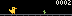

# What the Duck



A standalone BUSY Bar endless runner inspired by Chrome's dinosaur game. A yellow duck runs through a desert, jumps cacti, and speeds up as your score rises. Works entirely on the Bar; no Wi-Fi or desktop connection needed for play.

## Controls

| Control | Action |
| --- | --- |
| Start / OK / wheel | Start, jump, or retry after a collision |
| Hold OK | Pause / resume |
| Back | Quit |

The front display shows the game and score. The rear display shows the score, best score, and controls. During play, only the score line updates, at most once per second; state changes update immediately. Best score survives closing the app only on firmware that provides localStorage; otherwise it lasts for the current session. The launcher has a yellow duck icon and a matching monochrome rear icon.

## Build and install

Requires Node 22+ and BUSY Bar firmware 1.3.1 or newer (API 27.14.0).

```sh
npm ci
npm run format
npm run build
npm test
npm run check
npm run app:install
```

The package is `dist/me.molodtsov.what-the-duck.tgz`. Installation adds a separate app and launches it; SuperBar remains installed. Connect by USB at `10.0.4.20`, or configure `BUSY_BAR_URL` and optional `BUSY_BAR_TOKEN` in a gitignored `.env` for Wi-Fi installation.

```sh
npm run preview
```

Creates `dist/preview.html`, a standalone playable simulator. Open it locally and use Space, Up, or tap to jump; P pauses. The simulator uses the same physics and renderer as the device.

## Implementation

Physics uses a fixed 60 Hz step, with forgiving body collisions and obstacle gaps that allow landing before the next jump. The device targets 12.5 display updates per second, waits for each draw request, and yields at least 25 ms for buttons. Slow or failed display requests pause play. Native BUSY and calendar overlays keep their higher priority.

`shared/game.js` contains gameplay, `shared/render.js` contains both displays, and `src/main.js` contains device I/O. `scripts/icons.mjs` generates both launcher icons from exact pixel artwork. `test/` covers gameplay and the packaged JerryScript-compatible bundle.

## License

MIT for application code and original artwork. See [third-party notices](THIRD_PARTY_NOTICES.md) for bundled assets and their licenses.

Catalog builds use plain `busy-cli build`. Generated assets are committed; run `npm run generate` and commit its output when changing their sources.
